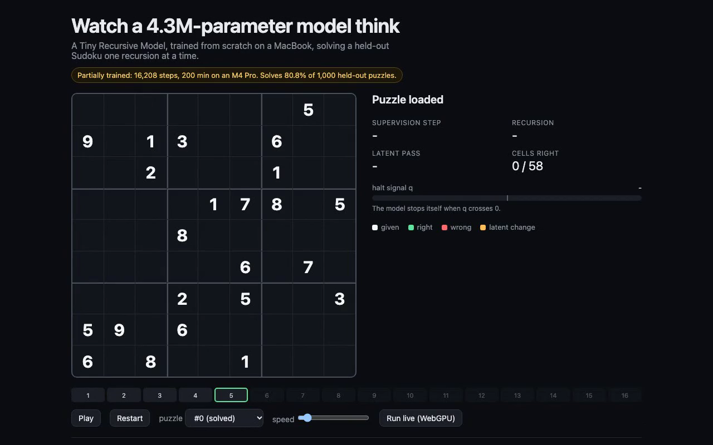

# trm-mlx-watch

Watch a 4.3M-parameter recursive model solve Sudoku, one pass at a time. It was trained from scratch on a MacBook.

[](clip/trm-solve.mp4)

*The clip is a headless replay of the exported trace (a test puzzle needing 1,727 solver guesses, halted at step 5), not a recording of live WebGPU.*

A clean-room Tiny Recursive Model (TRM, [arXiv 2510.04871](https://arxiv.org/abs/2510.04871)) in MLX, written from the paper's description with no official code read or copied. It is trained on hard Sudoku this repo generates. The browser visualizer replays a real solve one recursion pass at a time, and can recompute that solve in WebGPU from the exported weights.

## Results (checkpoint `runs/v0`)

All numbers come from this repo's own runs on its own puzzles, not from the paper.

| measure | value |
|---|---|
| parameters | 4,320,785 |
| training | 16,208 optimizer steps, 200 min, batch 32, M4 Pro (24 GB) |
| held-out test puzzles solved | **80.8% of 1,000** |
| how "solved" is checked | valid Sudoku, keeps every clue; matched the stored solution in all 808 cases |
| train-subset solved | 79.9% of 1,000 (no train/test gap) |
| by solver difficulty | easier third 80.7%, middle 85.3%, hardest 76.4% |
| mean supervision steps used | 6.2 of 16 (the model halts itself) |

Recursion does the work. On 500 held-out puzzles, the share solved after each supervision step: 0% after 1, 14.8% after 2, 62.0% after 4, 73.2% after 6, 81.0% after 16.

Training stopped early: the schedule planned 40,000 steps and the 200-minute cap stopped it at 16,208. One unstable stretch near step 7,900 (train accuracy fell from about 70% to 25%, recovered by 10,500) is in `runs/v0.log`.

### What these numbers are not

- **Not Sudoku-Extreme.** Puzzles come from this repo's own generator (minimal puzzles, hardest 40% of 50,000 by backtracking-solver guesses). This set is probably easier than the paper's, so 80.8% does not compare to the paper's figures.
- **Not 7M parameters.** This is the paper's attention-free variant, which the paper reports as its best Sudoku model.
- Isomorphic train/test overlap (same puzzle under a symmetry) was not checked. Very unlikely for random minimal puzzles, but unmeasured.

## The model (`trm/model.py`)

One small network (2 mixer blocks: an MLP across the 81 cells, then SwiGLU across channels) and three states per cell: `x` (the puzzle), `y` (the answer), `z` (a latent). Latent recursion runs `z = net(x + y + z)` six times then `y = net(y + z)`; deep supervision runs up to 16 deep recursions per puzzle, each its own optimizer step; a halt head trained with BCE stops the solve when it believes the grid is right.

## The visualizer (`viz/`)

The page replays an exported solve: green is right, red is wrong, brightness is confidence, the bar is the halt signal, and the amber glow is the size of each latent change. **Run live (WebGPU)** loads the same weights and recomputes the solve with WGSL compute shaders, then reports how many grids match the MLX trace (15 of 15 exact in headless Chromium on the software adapter; real-GPU speed unmeasured).

```sh
cd viz && python3 -m http.server 8000   # open http://localhost:8000
```

## Reproduce

```sh
uv venv -p 3.13 .venv && uv pip install -p .venv mlx numpy pytest
.venv/bin/python scripts/make_data.py --n 50000 --keep 0.4 --test 1000
.venv/bin/python -u -m trm.train --out runs/v0 --batch 32 --iters 40000 --minutes 200 --eval-every 2000 --eval-n 500 --warmup 1000
.venv/bin/python scripts/evaluate.py --run runs/v0
.venv/bin/python scripts/export.py --run runs/v0 --out viz/assets --traces 6 --pool 40
```

## Tests

`.venv/bin/python -m pytest -q tests` covers model size, state shapes, recursion trace order, no gradient through early recursions, clue-keeping decode, solver and augmentation validity, a training smoke run and the export format. `node tests/viz_smoke.mjs assets` checks the page renders the puzzle, shows the partial-training label and that live WebGPU agrees with the MLX trace.
